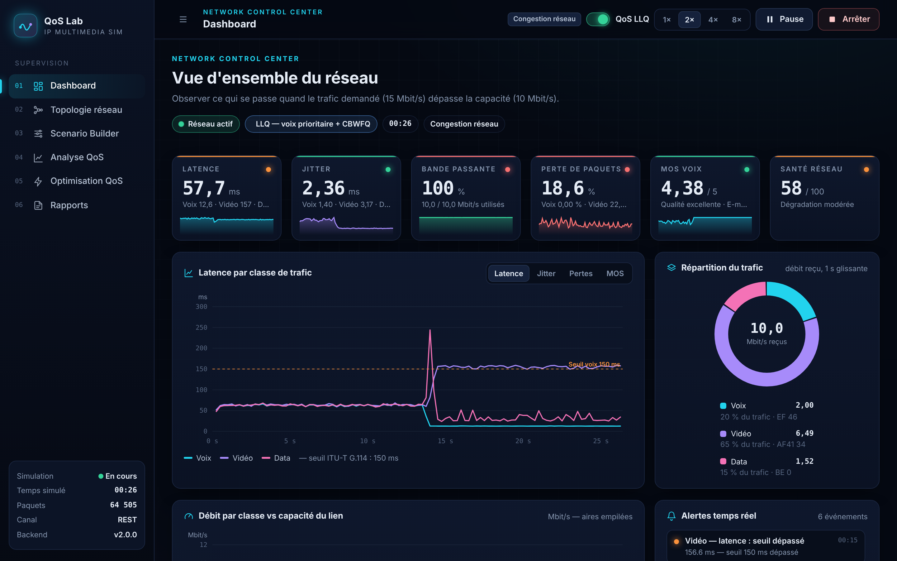

# Multimedia IP Network Simulator — QoS Lab

Projet 4 — **Simulateur de trafic multimédia IP**
Application web qui génère des flux **voix, vidéo et data** simulés, permet de **tester la QoS sur différents scénarios** et intègre des outils de mesure : **latence, jitter, bande passante, pertes de paquets et MOS**.



---

## 1. Démarrage rapide

```bash
pip install -r requirements.txt
python run.py                # ouvre http://127.0.0.1:8000
```

* Documentation interactive de l'API : <http://127.0.0.1:8000/docs>
* Sans aucune installation : `python run.py --lite` (serveur 100 % bibliothèque standard ; le temps réel passe alors par REST au lieu du WebSocket).
* Windows : double-cliquer sur `start.bat` — Linux/macOS : `./start.sh`.
* Tests : `python -m unittest discover -s tests -v`

Python ≥ 3.10. Le moteur de simulation n'a **aucune dépendance** ; FastAPI/uvicorn servent l'API et le WebSocket, ReportLab génère les PDF.

---

## 2. Fonctionnalités

| Page | Contenu |
|---|---|
| **01 Dashboard** | KPI temps réel (latence, jitter, utilisation, pertes, MOS, score de santé), latence/jitter/pertes/MOS par classe, débit empilé vs capacité, répartition du trafic, file du routeur, alertes, topologie animée |
| **02 Topologie** | Sources → switch → routeur goulot (files par classe) → WAN → routeur → récepteurs ; paquets animés, paquets perdus en rouge, liens colorés selon la congestion ; clic sur un équipement = statistiques + réglages à chaud ; ajout/suppression de clients VoIP, serveurs vidéo, hôtes data |
| **03 Scenario Builder** | 8 scénarios du laboratoire + éditeur complet (bande passante, latence, gigue, pertes aléatoires ou en rafales, buffer, QoS, poids WFQ, plafond LLQ, flux, codecs, profils vidéo, TCP/UDP), aperçu instantané de la charge, import/export JSON, scénarios enregistrés |
| **04 Analyse QoS** | Score de santé, cartes par classe avec conformité aux seuils ITU-T, jauge MOS, intégrité des images vidéo, goodput TCP, séries temporelles, **décomposition de la latence** (file / sérialisation / propagation : *pourquoi le réseau se dégrade*), distribution et percentiles, **Smart Advisor**, **balayages** de paramètres |
| **05 Optimisation QoS** | Même scénario, même graine, jusqu'à 4 politiques (FIFO, PQ, WFQ, LLQ) : gains chiffrés, graphiques avant/après, tableau des gains ; **optimisation automatique** progressive par le Smart Advisor |
| **06 Rapports** | Historique (SQLite) de toutes les simulations, aperçu, export **PDF** mis en page et **CSV** (séries temporelles), export JSON |

**Temps réel** : la simulation avance par tranches toutes les 200 ms (vitesse ×1 à ×8). On peut **activer la QoS, changer la bande passante, ajouter un flux… pendant la simulation** et voir immédiatement l'effet.

### Les 8 scénarios

1. **Réseau normal** — 2 flux voix, 1 vidéo, 3 data sur 100 Mbit/s : réseau stable.
2. **Congestion** — 15 Mbit/s demandés (voix 2 + vidéo 8 + data 5) pour 10 Mbit/s : file pleine, retards, pertes.
3. **Surcharge streaming vidéo** — balayage 1 / 5 / 10 / 20 flux vidéo.
4. **VoIP sous stress** — TCP remplit un buffer surdimensionné (*bufferbloat*) : latence voix > 150 ms, MOS < 4.
5. **Priorité QoS activée** — démonstration principale : sans QoS vs LLQ (voix prioritaire).
6. **Pertes de paquets** — balayage 0 / 1 / 5 / 10 % ; la QoS ne corrige pas les pertes du lien.
7. **Forte latence** — balayage 10 / 50 / 100 / 200 ms ; seuil de 150 ms (ITU-T G.114), débit TCP limité par le RTT.
8. **Scénario personnalisé** — point de départ du Scenario Builder.

### Démonstration conseillée (5 minutes)
1. Dashboard → scénario **Congestion réseau** → *Démarrer* (×4). Les indicateurs passent au rouge, les alertes s'affichent, des paquets rouges tombent au routeur.
2. Pendant la simulation, basculer **QoS** dans la barre du haut : la latence et les pertes voix chutent en quelques secondes, le MOS remonte.
3. *Arrêter* → **Analyse QoS** : décomposition de la latence et diagnostic du Smart Advisor.
4. **Optimisation QoS** → *Lancer la comparaison* (FIFO vs LLQ), puis *Optimiser automatiquement*.
5. **Rapports** → télécharger le PDF.

---

## 3. Modèle de simulation

Simulation **à événements discrets** (même principe que SimPy, implémenté dans `backend/simulation/engine.py`) : chaque paquet est suivi individuellement — émission, mise en file, sérialisation, propagation, réception ou perte.

```
Sources ──► Switch ──► [ Routeur R1 : buffer + ordonnanceur ] ══ lien goulot (bande passante) ══► WAN (latence, gigue, pertes) ──► R2 ──► Récepteurs
```

| Trafic | Modèle |
|---|---|
| **Voix** (RTP/UDP, DSCP EF) | 1 paquet toutes les 20 ms par appel ; G.711 = 160 o + 40 o d'en-têtes = **80 kbit/s IP** ; G.729 (24 kbit/s), G.723.1 |
| **Vidéo** (RTP/UDP, AF41) | images à fps constant, GOP de 30, images I ≈ 4× les P, taille VBR (log-normale), fragmentation en paquets de 1356 o émis en rafale |
| **Data** (BE) | **TCP Reno simplifié** (slow start, AIMD, réaction aux pertes ≈ 1 RTT) ou UDP de Poisson non réactif |

| Ordonnanceur | Comportement |
|---|---|
| **FIFO** | file unique, *tail-drop* — sans QoS |
| **PQ** | priorité stricte voix > vidéo > data (risque de famine) |
| **WFQ** | files pondérées (Deficit Round Robin) |
| **LLQ** | file prioritaire voix bornée par un *policer* + CBWFQ vidéo/data (modèle Cisco) |

Avec QoS, le buffer est partagé : chaque classe a un plafond et un paquet prioritaire peut évincer un paquet moins prioritaire (*push-out* selon la précédence DSCP).

### Mesures
* **Latence** = t_réception − t_émission (one-way, ms), moyenne, p50/p95/p99/max.
* **Jitter** RFC 3550 par appel/session : `J ← J + (|D| − J) / 16`.
* **Débit** = bits reçus / durée ; **pertes** = perdus / (reçus + perdus), par cause (buffer, lien, policer).
* **MOS estimé** — E-model ITU-T G.107 simplifié (Ie/Bpl : G.113). *C'est une estimation à partir des paramètres réseau simulés.*
* **Seuils** — voix/vidéo : latence ≤ 150 ms, jitter ≤ 30 ms, pertes ≤ 1 % ; data : latence ≤ 400 ms, pertes ≤ 2 %.
* **Score de santé** 0–100 pondéré (voix 40 %, vidéo 35 %, data 25 %).

La même graine aléatoire rejoue exactement le même trafic : la comparaison avec/sans QoS est équitable.

---

## 4. Architecture

```
multimedia-ip-simulator/
├── run.py                      lanceur (FastAPI, ou mode lite)
├── backend/
│   ├── config.py               codecs, profils, DSCP, seuils, validation des scénarios
│   ├── app.py                  API FastAPI + WebSocket /ws/live
│   ├── lite_server.py          même API REST, sans dépendance
│   ├── api/handlers.py         logique des endpoints (indépendante du framework)
│   ├── simulation/             ── MEMBRE 1
│   │   ├── engine.py           moteur à événements discrets + paquet
│   │   ├── traffic.py          générateurs voix / vidéo / data (TCP, UDP)
│   │   ├── network.py          routeur, files FIFO/PQ/WFQ/LLQ, lien WAN
│   │   └── simulator.py        assemblage, exécution batch / live, modifications à chaud
│   ├── qos/                    ── MEMBRE 2
│   │   ├── metrics.py          latence, jitter, débit, pertes, fenêtres, résumé
│   │   ├── mos.py              E-model, seuils, score de santé
│   │   └── advisor.py          QoS Smart Advisor (règles + patchs de configuration)
│   ├── scenarios/presets.py    les 8 scénarios + balayages
│   └── services/               comparaison, sweep, optimisation, live, historique, rapports PDF/CSV
├── frontend/                   ── MEMBRE 3 (HTML/CSS/JS modules, sans build ni dépendance)
│   ├── index.html, css/style.css
│   └── js/ app.js (navigation) · api.js (REST + WebSocket) · store.js (état) · charts.js (SVG)
│           topology.js (topologie animée) · pages/ (6 pages)
├── tests/test_simulator.py
└── docs/API.md
```

Le frontend n'utilise aucune bibliothèque externe (graphiques SVG faits maison) : il fonctionne hors ligne, ce qui est pratique en salle de démonstration.

### Répartition du travail (3 membres)
* **Membre 1 — Simulation & trafic** : `backend/simulation/`, `backend/scenarios/`.
* **Membre 2 — QoS, analyse & optimisation** : `backend/qos/`, `backend/services/`, rapports.
* **Membre 3 — Frontend & expérience utilisateur** : `frontend/`.
* Contrat d'interface commun : format des scénarios (`config.py`) et des résultats (`docs/API.md`).

### Reprise du premier prototype
Les fonctions du premier prototype (`calculate_average_latency`, `calculate_jitter`, `calculate_bandwidth`, `calculate_packet_loss`, `calculate_improvement`) sont conservées dans `backend/qos/metrics.py`, mais elles sont désormais appliquées à de vrais paquets simulés et non à des valeurs aléatoires.
